# Liquid Glass (Backdrop)


A customizable Liquid Glass effect library for Compose Multiplatform.

## Docs

[](https://central.sonatype.com/artifact/io.github.kyant0/backdrop)

[Documentation](https://kyant.gitbook.io/backdrop)

## JitPack

```kotlin
// settings.gradle.kts
dependencyResolutionManagement {
    repositories {
        google()
        mavenCentral()
        maven("https://jitpack.io")
    }
}

// build.gradle.kts
dependencies {
    // iOS 26 Liquid Glass components (also pulls in :backdrop)
    implementation("com.github.tqmane.AndroidLiquidGlass:components:<tag or commit>")
    // or only the low-level backdrop / glass effects
    implementation("com.github.tqmane.AndroidLiquidGlass:backdrop:<tag or commit>")
}
```

[](https://jitpack.io/#tqmane/AndroidLiquidGlass)

## Components

See the [implementation guide](docs/IMPLEMENTATION_GUIDE.md) for the architecture, every iOS 26 component in the catalog (segmented control, sheets, alerts, menus, video player, ...), and common pitfalls.

The library does not include any high-level components; you will need to create your own.
Below are some example components:

- [LiquidButton](/app/src/commonMain/kotlin/com/kyant/backdrop/catalog/components/LiquidButton.kt)
- [LiquidToggle](/app/src/commonMain/kotlin/com/kyant/backdrop/catalog/components/LiquidToggle.kt)
- [LiquidSlider](/app/src/commonMain/kotlin/com/kyant/backdrop/catalog/components/LiquidSlider.kt)
- [LiquidBottomTabs](/app/src/commonMain/kotlin/com/kyant/backdrop/catalog/components/LiquidBottomTabs.kt)

## Comparison with iOS 26

Screenshots of the iOS 26 simulator next to the [catalog app](#demo) on an Android emulator. Each image shows iOS on the left and Android on the right, in light and dark mode.

### Buttons

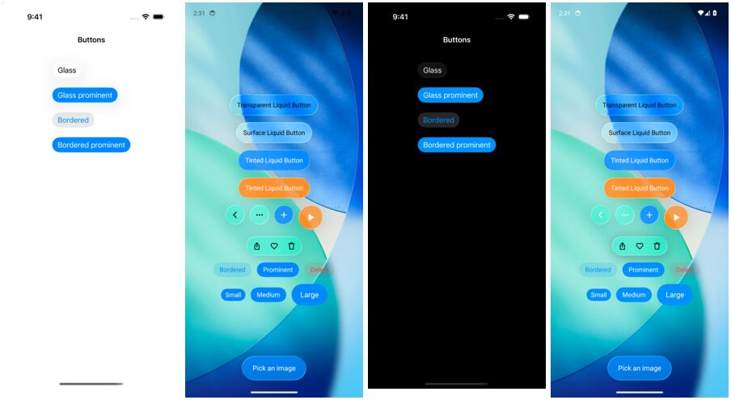

### Segmented control

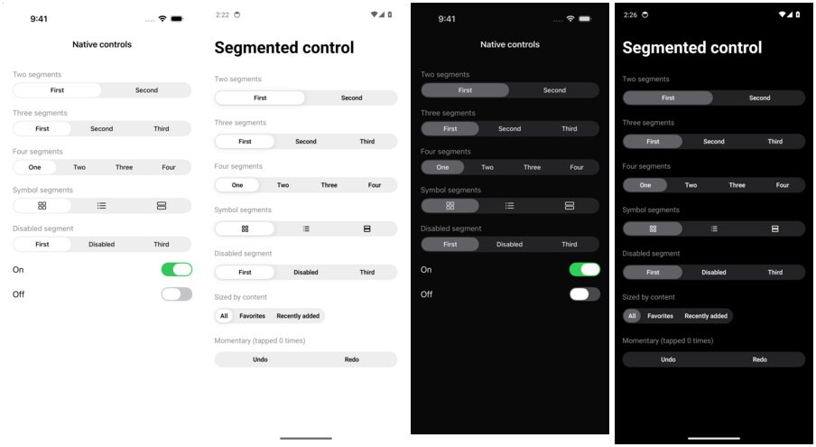

### Stepper

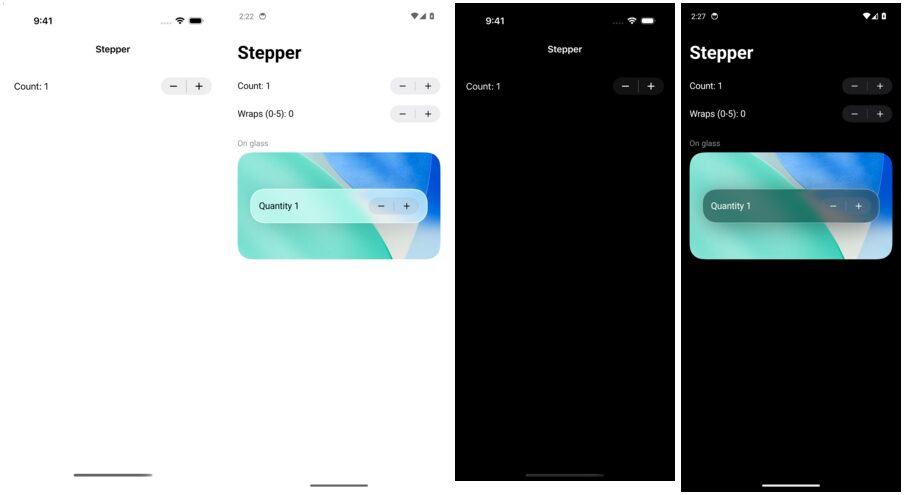

### Page control

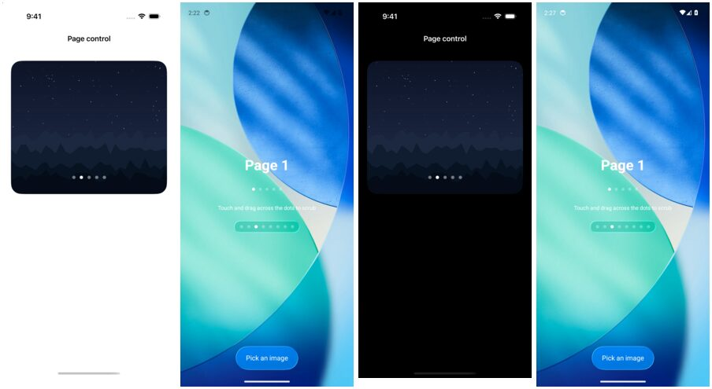

### Progress and activity indicators

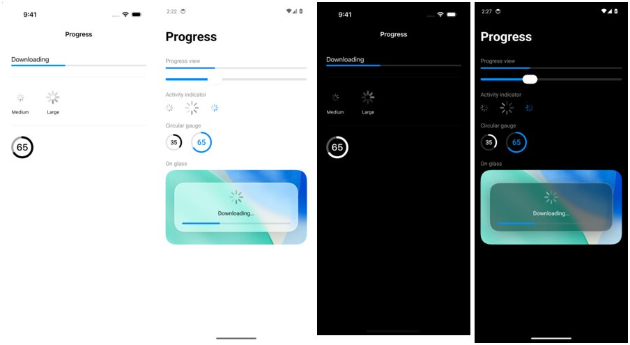

### Search bar

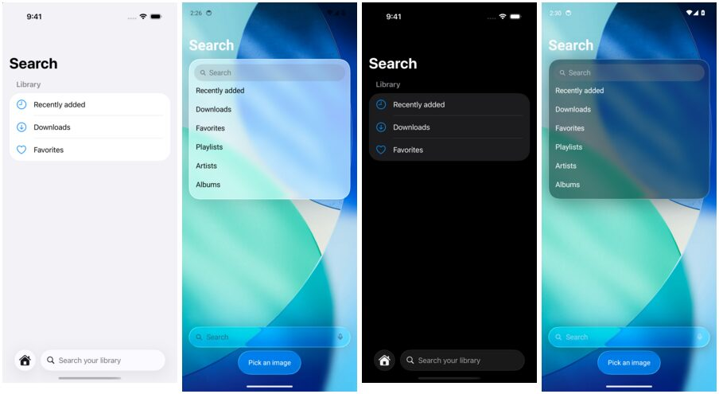

### Toolbar and navigation bar

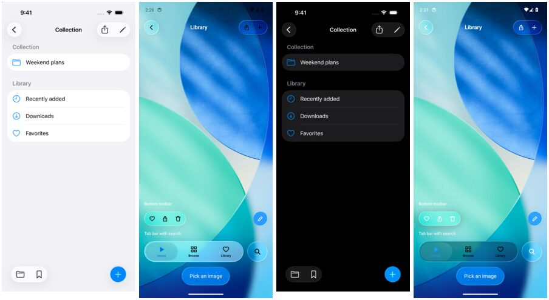

### Menu

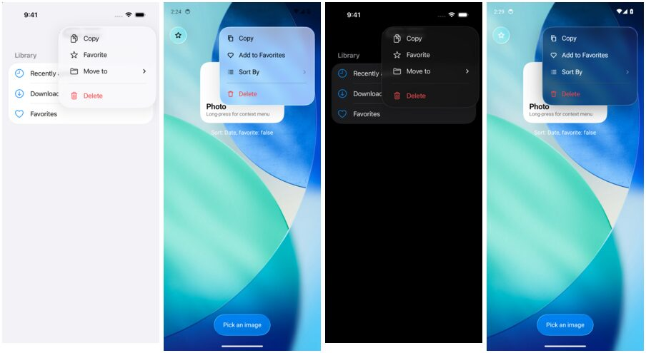

### Context menu

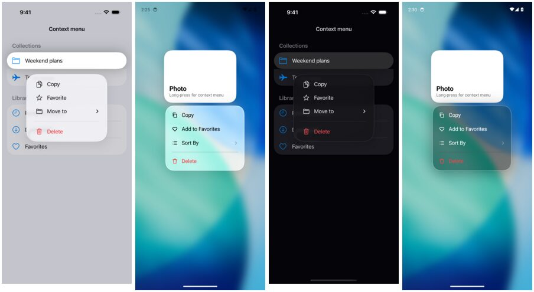

### Popover

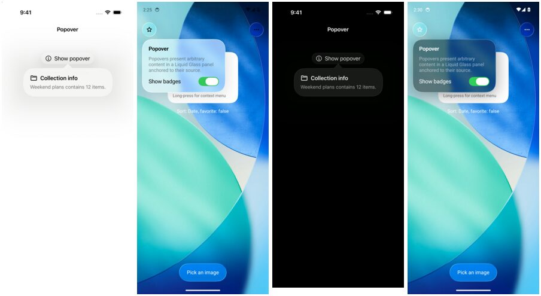

### Sheet (medium detent)

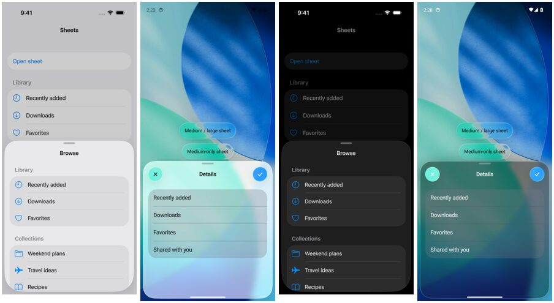

### Sheet (large detent)

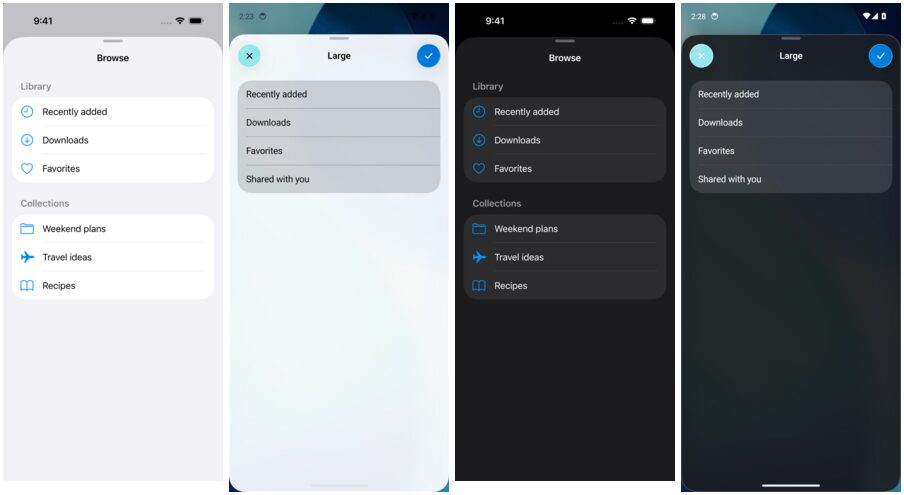

### Alert (two buttons)

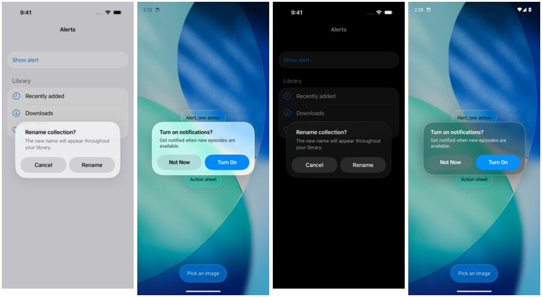

### Alert (three buttons)

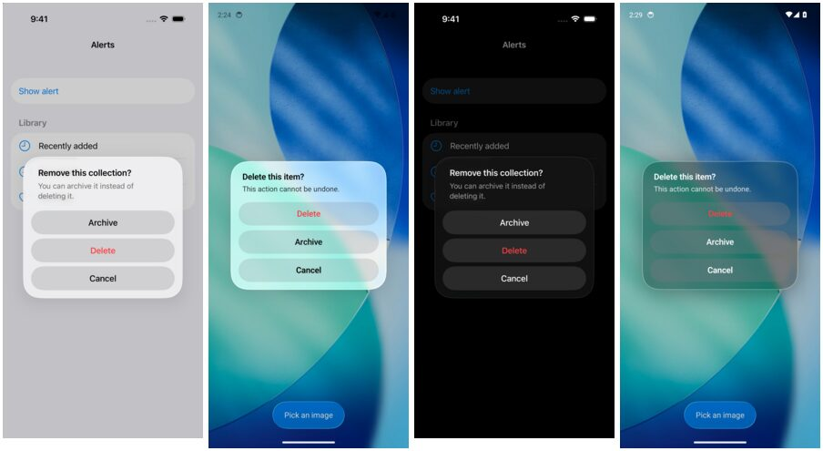

### Materials

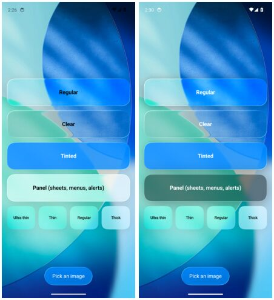

### Bottom tab bar

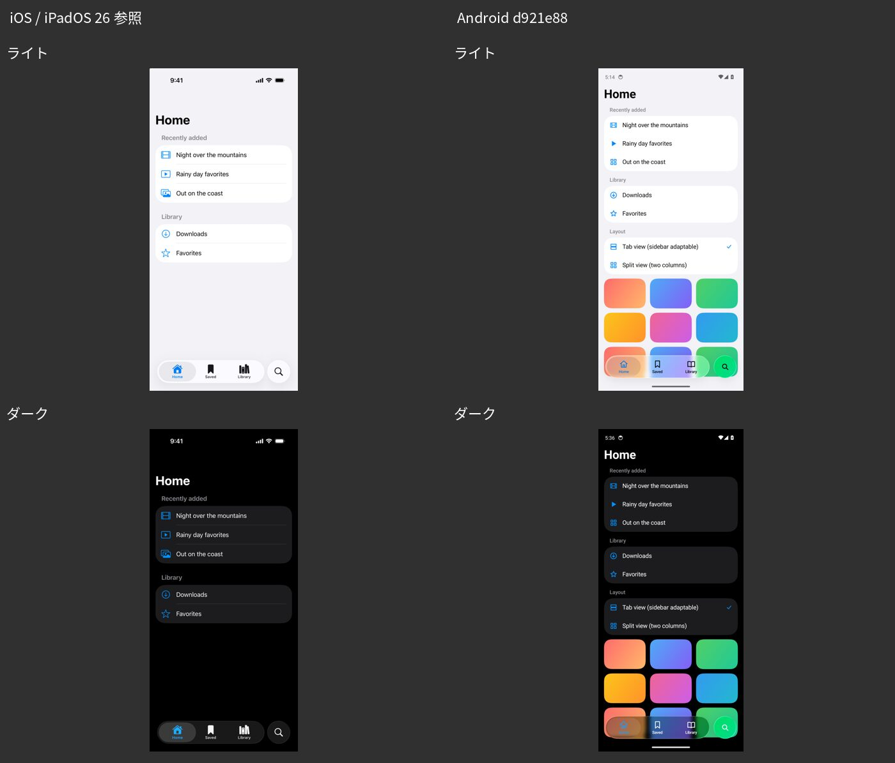

### iPad top tab bar

| iOS 26 (iPad) | Android (tablet) |
| --- | --- |
| 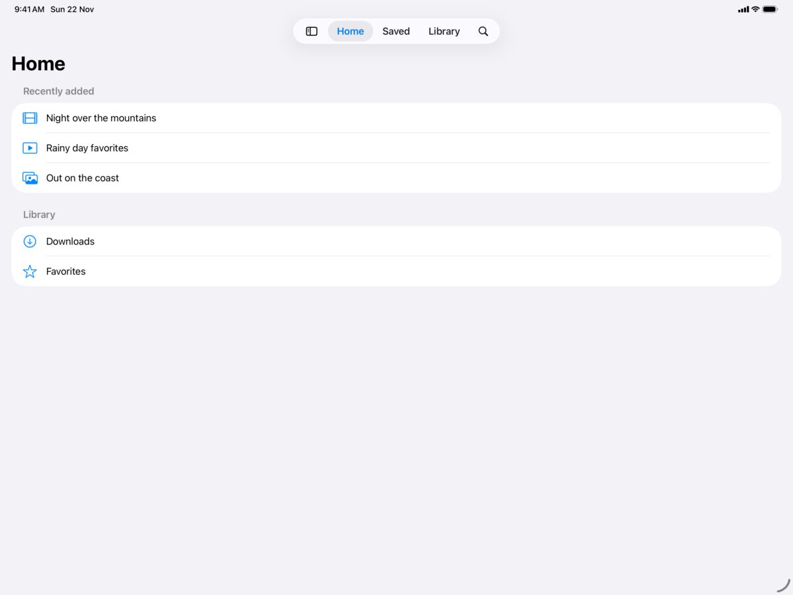 | 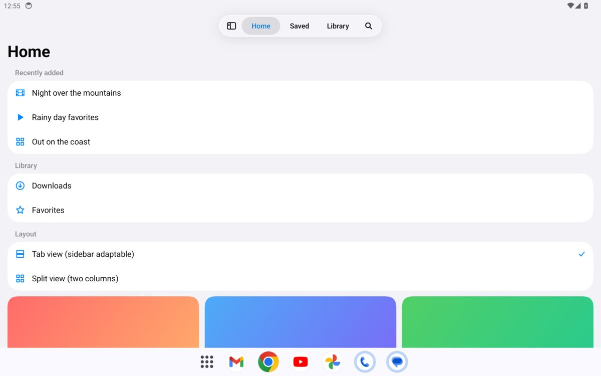 |
| 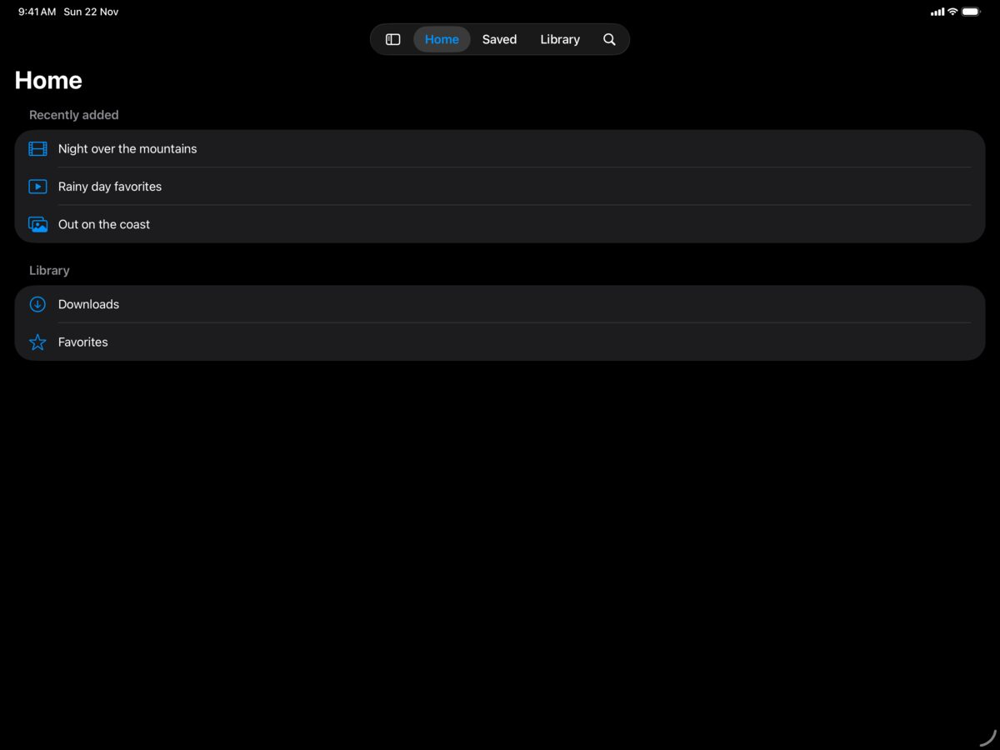 | 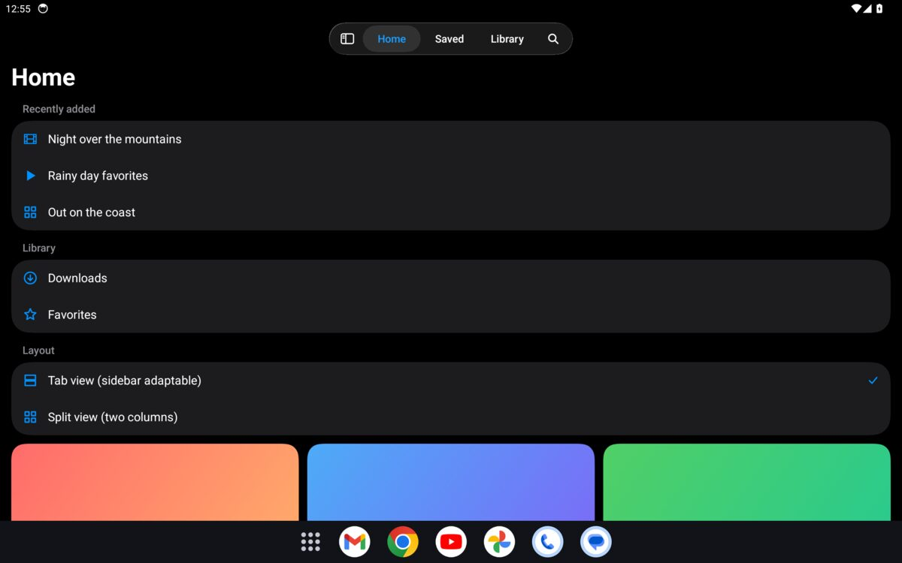 |

## Motion comparison with iOS 26

The animations were matched frame by frame against slow-motion iOS 26 simulator recordings. In each strip, the top row is iOS and the bottom row is Android, sampled at the same timestamps. Click a strip to view it at full size.

### Segmented control tap


### Glass button press


### Sheet present


### Sheet detent expand


### Sheet dismiss


### Alert present


### Action sheet present


### Search open (tab bar morph)


### Search cancel


### Search return to Home


### iPad popover dialog


### iPad sheet present


## Demo

- [Backdrop Catalog](./androidApp/release/androidApp-release.apk)


